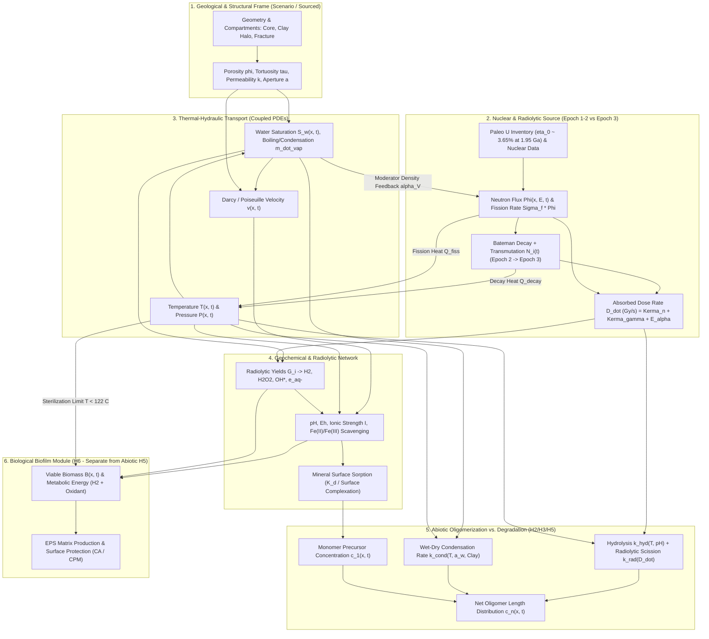

# Proto-Biofilms, Hydrothermal Geysers, and Natural Fission: An Evidence-Gated Multiphysics Research Program

> [!IMPORTANT]
> **Central Research Framing & Epistemic Boundary**
> - **Central Question:** Which links in a proposed causal chain connecting natural nuclear fission, water radiolysis, hydrothermal or geyser-like cycling, uraninite-sandstone-clay-fracture geometry, mineral-assisted prebiotic chemistry, and biofilm-like organization are supported by independent evidence, which are physically plausible analogies, and which remain unoperationalized speculation?
> - **Case-Study Discipline:** Oklo (Franceville Basin, Gabon, $\sim 1.95\text{ to }2.05\text{ Ga}$) is treated strictly as a natural-fission and geochemical benchmark case study. Because the Paleoproterozoic Oklo reactors operated roughly $1.5\text{ to }2.0\text{ billion years}$ after the earliest terrestrial biosignatures, Oklo is **not** assumed to be the historical site where life, RNA, or proto-biofilms originated.
> - **Tooling Provenance Qualification:**
>   1. **Consensus:** Monthly research-thread quota was exhausted during this session; **no completed Consensus synthesis is claimed**.
>   2. **alphaXiv & Primary Theoretical Literature:** Audited non-equilibrium wet-dry cycling catalysis ([`arXiv:2304.14442`](https://arxiv.org/abs/2304.14442)), RNA-like polymerization kinetics ([`arXiv:1910.11484`](https://arxiv.org/abs/1910.11484)), and mesoscopic bacterial biofilm mechanics ([`arXiv:2607.23677`](https://arxiv.org/abs/2607.23677)).
>   3. **SciSpace & Primary Experimental Literature:** Audited primary geochemical, nuclear, radiolytic, mineralogical, and subsurface-microbiology studies (Bodu et al. 1972; Neuilly et al. 1972; Dubessy et al. 1988; Ferris et al. 1996; Meshik et al. 2004; Lin et al. 2005; Gauthier-Lafaye et al. 1996; Adam et al. 2018; Ibekwe et al. 2020).
>   4. **GitHub Implementation & Gate Audit:** Audited [`aurascoper/Biofilms`](https://github.com/aurascoper/Biofilms) (`42b621c56d845622fe5a10040a4ff8ae5730c188`), [`aurascoper/rna_biofilm_toy`](https://github.com/aurascoper/rna_biofilm_toy) (`599fb72ce68fb2ba7edcc18a9103c75a8f6a6cd2`), [`aurascoper/oklo_pool_mobile`](https://github.com/aurascoper/oklo_pool_mobile) (`main` at `942e3f8d02a3b73cfb26f099dbb36c4a908f6764`), and the frozen Revision-0 GUI conformance fixture in [`oklo_gui_scratch/`](file:///Users/aurascoper/.gemini/antigravity/scratch/oklo_gui_scratch/CONFORMANCE_FIXTURE_SPEC.md).

---

## 1. Executive Synthesis

A scientifically defensible evaluation of the "nuclear geyser to proto-biofilm" concept requires decomposing a single narrative into **six distinct component hypotheses ($H_1$ through $H_6$) plus an explicit null/alternative arm ($H_0$)**. Component-level support varies by five orders of magnitude in empirical maturity:

1. **Strongest Presently Supported Component ($H_1$ -- Radiolysis-Supported Subsurface Ecology):**
   Water radiolysis driven by $\alpha$, $\beta$, and $\gamma$ decay in uranium-bearing crustal rock is a directly measured physical process ($G(\text{H}_2) \approx 0.40\text{ molecules}/100\text{ eV}$ for $\gamma$ radiolysis; higher for high-LET $\alpha$ particles) that sustains deep continental subsurface lithoautotrophic microbial communities (`Lin et al., 2005`). This mechanism requires **neither nuclear criticality nor geyser boiling**.
2. **Experimentally Demonstrated Laboratory Mechanism ($H_2$ & $H_3$ -- Mineral-Assisted Wet-Dry Oligomerization):**
   Montmorillonite clay catalysis of chemically activated nucleotides (e.g., $\text{ImpA}$ yielding up to 30-to-50-mers, `Ferris et al., 1996`) and non-equilibrium wet-dry cycling driving condensation over hydrolysis (`arXiv:2304.14442`; `Da Silva et al., 2015`) are experimentally and theoretically established under **controlled, purified laboratory conditions**. However, transferring these results to an unpurified, high-ionic-strength, radiation-intense hydrothermal fracture remains experimentally undemonstrated.
3. **Model-Based Isotopic Inference ($H_4$ -- Fission-Modulated Hydrothermal Cycling):**
   The $\sim 30\text{ min}$ active / $\sim 2.5\text{ hr}$ dormant cycle at Oklo (`Meshik et al., 2004`) is a model-based interpretation of fissiogenic xenon isotope ratios (${}^{131}\text{Xe}, {}^{132}\text{Xe}, {}^{134}\text{Xe}, {}^{136}\text{Xe}$) trapped in alumino-phosphate grains, supported by 1D/2D coupled neutronic-thermal-hydraulic simulations (`Ibekwe et al., 2020`). It is **not** a direct measurement of surface geyser discharge, fracture desiccation, or organic synthesis.
4. **Most Uncertain Bridge in the Causal Chain ($H_4 \to H_5$ -- Coupling Fission-Pulsed Hydrothermal Cycling to Net Abiotic Oligomer Accumulation):**
   The critical unverified bridge is whether a fission-heated, radiolytic hydrothermal conduit yields **net oligomer synthesis rather than net radiolytic scission and hydrothermal hydrolysis**. High temperatures ($150\text{ to }300\,^\circ\text{C}$) accelerate phosphodiester and peptide hydrolysis exponentially, while ionizing radiation ($>1\text{ kGy}$) cleaves biopolymers via $\text{OH}^\bullet$ radical attack unless rapid transport into a cool, shielded, low-activity clay/fracture trap occurs on a timescale shorter than both radical lifetime and strand cleavage.
5. **Strict Separation of Abiotic Oligomers ($H_5$) from Biological Biofilms ($H_6$):**
   Abiotic surface-adsorbed oligomers ($<50\text{ nt}$) are not living biofilms. Biological biofilms require cellular metabolism, replication, and secreted extracellular polymeric substances (EPS). In existing codebase terms, [`aurascoper/rna_biofilm_toy`](https://github.com/aurascoper/rna_biofilm_toy) is a 2D synthetic cellular automaton with no RNA chemistry, and [`aurascoper/Biofilms`](https://github.com/aurascoper/Biofilms) is a Cellular Potts framework whose coupled OpenMC transport gate (`validate_coupled_config`) intentionally refuses execution until physical lattice pitch `dx` and material density `rho` are calibrated.

---

## 2. Six-Tier Evidence Classification & Primary Literature Registry

Every claim is classified into one of six strict epistemic tiers:
- **Tier E-I:** `Direct observation or measurement` (field sample or direct physical measurement)
- **Tier E-II:** `Experimentally demonstrated mechanism under specified laboratory conditions`
- **Tier E-III:** `Model-based inference constrained by data`
- **Tier E-IV:** `Analogy from another environment or system`
- **Tier E-V:** `Scenario assumption` (uncalibrated parameter or geometric idealization)
- **Tier E-VI:** `Speculation not yet operationalized`

| Source / Study | System & Sample Studied | Scale (Length / Time) | Methods & Quantified Results | Evidence Tier | What the Source Does NOT Establish |
| :--- | :--- | :--- | :--- | :--- | :--- |
| **Bodu et al. (1972); Neuilly et al. (1972)** *C. R. Acad. Sci. Paris* 275:1847 & 1857 | Oklo uranium ore (Zones 1 and 2, Franceville Basin, Gabon) | $\text{mm}$ to $\text{m}$ ore lenses; $\sim 1.95\text{ Ga}$ age | Mass spectrometry of uranium and rare-earth fission products ($\text{Nd}, \text{Sm}, \text{Eu}$): ${}^{235}\text{U}$ depleted down to $0.440\text{ atom}\%$ vs. $0.7202\text{ atom}\%$ present-day standard | **Tier E-I** (`Direct observation or measurement`) | Does not measure hydrothermal geyser periodicity, fracture saturation, or organic/prebiotic chemistry |
| **Gauthier-Lafaye et al. (1996)** *Geochim. Cosmochim. Acta* 60(23):4831-4852 | Oklo reactor zones 1 to 16 & Bangombe (FA sandstone, black shales, clay halos) | $\text{cm}$ to $\text{km}$ basin scale; $\sim 2.0\text{ Ga}$ | Petrography, U-Pb / Sm-Nd isotope geochemistry, fluid inclusions: reactor cores encased in desilicified argillaceous (illite/chlorite) clay halos formed by hydrothermal alteration of sandstone at $250\text{ to }400\,^\circ\text{C}$ | **Tier E-I** (`Direct observation or measurement`) | Does not show surface geyser venting to the atmosphere or prebiotic polymer synthesis |
| **Dubessy et al. (1988)** *Geochim. Cosmochim. Acta* 52(5):1155-1167 | Quartz vein fluid inclusions from Oklo and rabbit-lake U deposits | $5\text{ to }50\,\mu\text{m}$ inclusions; geological trapping time | Micro-Raman spectroscopy: detected $\text{H}_2$ and $\text{CH}_4$ (with disequilibrium $\text{H}_2/\text{CH}_4$ and $\text{O}_2$ absence) in fluid inclusions irradiated by $\alpha/\gamma$ decay | **Tier E-I** (`Direct observation or measurement`) | Does not give a continuous 3D spatial $\text{H}_2$ concentration field or prove biological methanogenesis |
| **Lin et al. (2005)** *Geochem. Geophys. Geosyst.* 6:Q07003 ([DOI:10.1029/2004GC000907](https://doi.org/10.1029/2004GC000907)) | Witwatersrand Basin deep fracture waters (South Africa, $0.8\text{ to }3.2\text{ km}$ depth) & lab $\gamma$ radiolysis | Lab vials ($\text{cm}$, hours/days) to $\text{km}$ aquifers ($\text{Myr}$) | Measured $G(\text{H}_2) = 0.40 \pm 0.04\text{ molec}/100\text{ eV}$ (${}^{137}\text{Cs}$ $\gamma$ source); combined with $\alpha/\beta/\gamma$ dose models to explain up to $\text{mM}$ dissolved $\text{H}_2$ supporting subsurface sulfate-reducing microbes | **Tier E-II** (lab $G$-value) & **Tier E-III** (crustal $\text{H}_2$ model) | Does not involve nuclear criticality, geysers, or abiotic RNA polymerization |
| **Meshik et al. (2004)** *Phys. Rev. Lett.* 93:182302 ([DOI:10.1103/PhysRevLett.93.182302](https://doi.org/10.1103/PhysRevLett.93.182302)) | Alumino-phosphate (crandallite-goyazite) grains from Oklo Zone 13 | $\sim 100\,\mu\text{m}$ mineral grains; $\sim 3\text{ hr}$ inferred cycle | Laser microprobe noble-gas mass spectrometry: anomalous ${}^{131}\text{Xe}/{}^{134}\text{Xe}$ and ${}^{132}\text{Xe}/{}^{136}\text{Xe}$ ratios fitted to $\text{I}/\text{Te}$ $\beta$-decay half-lives under a $30\text{ min}$ ON / $150\text{ min}$ OFF neutron-flux square wave | **Tier E-I** (Xe isotope ratios) & **Tier E-III** (cycling timing inference) | Does not directly observe water boiling, steam chimney geometry, or temperature traces; internal ENDF rerun (`oklo_heartbeat` B0) noted non-reproduction of the exact fit |
| **Ibekwe et al. (2020)** *Prog. Nucl. Energy* 118:103080 | Coupled neutronics + porous-medium thermal-hydraulics model of Oklo | $\text{m}$-scale core; minutes to hours | Numerical PDE simulation reproducing self-regulated $\sim 3\text{ hr}$ thermal-hydraulic criticality oscillations via water density/void reactivity feedback | **Tier E-III** (`Model-based inference constrained by data`) | Computational plausibility proof only; depends on assumed permeability and boundary recharge rates |
| **Ferris et al. (1996)** *Nature* 381:59-61 ([DOI:10.1038/381059a0](https://doi.org/10.1038/381059a0)) | Purified $\text{Na}^+$-montmorillonite clay + phosphorimidazolide-activated monomers ($\text{ImpA}$, $\text{ImpU}$) | Test tube ($\text{mL}$); daily feeding over $14\text{ days}$ at $25\,^\circ\text{C}$, $\text{pH } 8$ | Gel electrophoresis & HPLC: synthesis of RNA oligomers up to $30\text{ to }50\text{ monomers}$ long on clay interlayers | **Tier E-II** (`Experimentally demonstrated mechanism`) | Requires pre-synthesized, chemically activated phosphorimidazolides at $25\,^\circ\text{C}$ in purified buffer without ionizing radiation or hydrothermal hydrolysis |
| **Buslaev et al. (2023)** [`arXiv:2304.14442`](https://arxiv.org/abs/2304.14442) | Theoretical chemical-kinetics model of wet-dry phase cycling | Mesoscopic droplet / film; cycle period $\tau$ | Analytical & numerical master equations: non-equilibrium wet-dry cycling acts as an effective thermodynamic catalyst, shifting steady-state dimer/oligomer yields above equilibrium | **Tier E-III** (theoretical mechanism) | Abstract kinetic proof; does not parameterize uraninite radiation fields or clay porewater |
| **Tjhung et al. (2019); Hartmann et al. (2026)** [`arXiv:1910.11484`](https://arxiv.org/abs/1910.11484), [`arXiv:2607.23677`](https://arxiv.org/abs/2607.23677) | Theoretical polymerization & mesoscopic bacterial biofilm mechanics | $\mu\text{m}$ to $\text{mm}$; minutes to days | Continuum/agent-based mechanics of living bacterial biofilms and template-free polymerization length distributions | **Tier E-IV** (`Analogy from another system`) | Models either idealized chemical chains or modern cellular bacteria, not radiolytic prebiotic proto-biofilms |
| **Ebisuzaki & Maruyama (2017); Adam et al. (2018)** *Geosci. Front.* 8:275; *Sci. Rep.* 8:265 | Nuclear geyser origin-of-life hypothesis & radiolytic precursor synthesis | Conceptual basin / lab $\gamma$ radiolysis of $\text{N}_2/\text{CO}_2/\text{H}_2\text{O}$ | Proposes that natural nuclear geysers supplied radiolytic radicals, wet-dry cycles, and clay surfaces for prebiotic synthesis | **Tier E-IV / E-VI** (published hypothesis & radiolytic precursor analogy) | Does not demonstrate coupled criticality + hydrothermal venting + net oligomer accumulation in an Oklo-like rock-water system |
| **`aurascoper/Biofilms` & `rna_biofilm_toy`** | GitHub repositories (`42b621c` and `599fb72`) | 2D/3D lattice grids (`lattice_units`, `mcs`) | `Biofilms`: Cellular Potts + PDE + blocked OpenMC adapter (`validate_coupled_config` refuses uncalibrated `dx`/`rho`). `rna_biofilm_toy`: 2D spatial protection CA (`no RNA chemistry`) | **Software Verification Baselines** (`numerically_verified_synthetic_model`) | Explicitly refuse to claim physical calibration, radiotrophic growth, or historical origin-of-life validation |

---

## 3. Ranked Competing-Hypothesis Matrix ($H_1$ to $H_6$ and $H_0$)

Each hypothesis is evaluated independently before considering any conjunction ($\bigwedge_m H_m$). By probability theory, the conjunction $P(H_1 \land H_2 \land H_3 \land H_4 \land H_5)$ cannot exceed its weakest link.

| Rank & ID | Hypothesis Statement | Positive Evidence (Tier) | Contrary Evidence & Confounders | Required Assumptions | Falsifiable Predictions | Smallest Discriminating Experiment / Observation |
| :--- | :--- | :--- | :--- | :--- | :--- | :--- |
| **Rank 1: $H_1$** | **Radiolysis-Supported Subsurface Ecology:** Radioactive decay ($\alpha, \beta, \gamma$) in water-bearing U-rich rock generates $\text{H}_2$ and oxidants ($\text{H}_2\text{O}_2, \text{SO}_4^{2-}, \text{Fe(III)}$) that can sustain subsurface chemolithoautotrophs | `Lin et al. (2005)` Witwatersrand $\text{H}_2$ budget (E-I/E-II); `Dubessy et al. (1988)` Oklo fluid-inclusion $\text{H}_2$ (E-I); `Dzaugis et al. (2016)` $\alpha$-radiolysis yields | Abiotic serpentinization or cataclasis can also generate $\text{H}_2$; simultaneous production of $\text{H}_2\text{O}_2/\text{O}_2$ can re-oxidize $\text{H}_2$ unless scavenged by $\text{Fe(II)}$ sulfides/clays | Porewater access to U-bearing mineral grain boundaries within $\alpha$-stopping range ($\sim 20\text{ to }40\,\mu\text{m}$) or $\gamma$ range ($\sim 10\text{ cm}$) | Steady-state $[\text{H}_2]$ and $[\text{SO}_4^{2-}]$ scale linearly with local dose rate $\dot{D}$ and water-filled porosity $\phi S_w$ in sterile rock-water microcosms | **Experiment D1:** Sealed, anoxic wet uraninite + illite/chlorite microcosm vs. unirradiated control: measure $\text{H}_2(\text{g})$, $\text{H}_2\text{O}_2$, and $\text{Fe(II)}/\text{Fe(III)}$ vs. absorbed dose ($\text{Gy}$) |
| **Rank 2: $H_2$** | **Mineral-Assisted Prebiotic Chemistry:** Clay (montmorillonite, illite) and phosphate (apatite/crandallite) surfaces adsorb monomers, concentrate reactants, and catalyze oligomerization without requiring fission | `Ferris et al. (1996)` 30-to-50-mer RNA on montmorillonite (E-II); `Hashizume (2015)` ribose/phosphate adsorption on clays (E-II) | High divalent cations ($\text{Mg}^{2+}, \text{Ca}^{2+}$), low $\text{pH}$, or strong phosphate binding on crandallite can irreversibly lock monomers and block strand elongation; illite/chlorite at Oklo has lower interlayer swelling than smectite | Availability of activated monomers, favorable interlayer cation exchange, and desorption pathways | Oligomer chain-length distribution $c_n$ shifts to larger $n$ in the presence of Oklo-analog illite/smectite + apatite vs. bulk solution at identical $T(t)$ | **Experiment D2:** Isothermal ($25\text{ to }80\,^\circ\text{C}$) monomer oligomerization assay comparing (a) purified Na-montmorillonite, (b) Francevillian illite/chlorite + crandallite, and (c) mineral-free buffer |
| **Rank 3: $H_3$** | **Non-Equilibrium Hydrothermal Wet-Dry Cycling:** Periodic evaporation, desiccation, and rewetting shift condensation-hydrolysis equilibria toward oligomer synthesis | `Da Silva et al. (2015)`; `DeGuzman et al. (2014)`; `Buslaev et al. (2023)` (`arXiv:2304.14442`) (E-II / E-III) | Prolonged high-temperature wet phases hydrolyze phosphodiester bonds faster than dry phases condense them (`Mulkidjanian et al., 2012`); salt deliquescence can prevent complete drying | Dry-phase residence time $\tau_{\mathrm{dry}}$ and temperature $T_{\mathrm{dry}}$ sufficient to remove water activity $a_w \ll 1$ without thermal charring, followed by cool rehydration | Cyclic wet-dry protocol ($N$ cycles of $\tau_{\mathrm{dry}} + \tau_{\mathrm{wet}}$) produces higher dimer/trimer/oligomer yield than any static $a_w$ control at the same mean temperature | **Experiment D3:** Automated microfluidic/autoclave cycling ($30\text{ min}$ dry bake / $150\text{ min}$ cool wet recharge) vs. static wet and static dry controls at matched $\int T\,dt$ |
| **Rank 4: $H_4$** | **Fission-Modulated Hydrothermal Cycling:** Self-regulated nuclear criticality in a saturated U-rich core periodically boils porewater, expels fluid along a fracture, shuts down via void feedback, and restarts upon groundwater recharge | `Meshik et al. (2004)` Xe isotopic retention (E-I/E-III); `Ibekwe et al. (2020)` coupled neutronic-porous-flow model (E-III) | Subsurface supercritical/high-pressure confinement at $2\text{ to }3\text{ km}$ burial depth (`Gauthier-Lafaye et al., 1996`) may suppress two-phase boiling into single-phase convective plumes rather than a surface-venting geyser | Initial $\sim 2.0\text{ Ga}$ enrichment ($\eta \approx 3.6\%$), low neutron-poison abundance ($\text{B}, \text{Sm}, \text{Gd}$), negative void reactivity coefficient $\alpha_V < 0$, and fracture permeability $k_f$ tuned to $\sim 2.5\text{ hr}$ recharge | Coupled neutronic-TH solve predicts limit-cycle oscillations in $k_{\mathrm{eff}}(t)$, $T(t)$, and liquid saturation $S_w(t)$ only within a bounded $(k_{\mathrm{clay}}, k_{\mathrm{frac}}, q_{\mathrm{fiss}})$ stability island | **Benchmark D4:** Coupled 1D/2D transient finite-volume TH + two-group diffusion benchmark mapping the $(k_{\mathrm{frac}}, \dot{Q}_{\mathrm{fiss}})$ Hopf bifurcation boundary |
| **Rank 5: $H_6$** | **Biological Biofilm Colonization & EPS Matrix Protection:** Existing microorganisms colonize mineral/fracture surfaces, secrete EPS, and attenuate chemical or radiative stressors | Modern subsurface biofilms in deep fractures (`Wanger et al., 2006`); fungal/melanin radiation shielding studies (`Dadachova et al., 2007`); R6A `surface_matrix_protection_v0` (E-II / E-IV) | Requires **pre-existing living cells** with intact DNA repair ($\text{ Deinococcus}$ / fungal melanin pathways); cannot explain prebiotic abiogenesis | Viable inoculum, electron donor/acceptor disequilibrium ($\text{H}_2/\text{SO}_4^{2-}$), and $T < 122\,^\circ\text{C}$ (upper temperature limit of life) in peripheral fracture zones | Living biofilm biomass and EPS localize in the $T < 90\,^\circ\text{C}$ peripheral redox-mixing halo (`Zone 2/3` boundary), not in the $>200\,^\circ\text{C}$ sterilizing core | **Experiment D6:** Dual-tracer transport & survival assay comparing EPS-coated vs. bare clay/sandstone cores under $\gamma$/$\text{H}_2\text{O}_2$ challenge (R6A controls C1 to C7) |
| **Rank 6: $H_5$** | **Fission-Assisted Prebiotic Organization ("Proto-Biofilm" Emergence):** Fission pulsing, radiolysis, clay catalysis, and fracture transport jointly produce net oligomer accumulation and surface-bound prebiotic organization | Individual mechanisms ($H_1, H_2, H_3, H_4$) exist in isolation | **Radiation-hydrolysis paradox:** $\gamma$/$\alpha$ dose rates that generate $\text{H}_2$ also generate $\text{OH}^\bullet$ radicals that cleave oligomers (`G(scission)`), while $200\text{ to }350\,^\circ\text{C}$ core pulses rapidly hydrolyze RNA/peptides | Spatial decoupling: radiolytic precursors generated in the core must advect into a cooler ($<80\,^\circ\text{C}$), radiation-shielded clay/fracture zone where wet-dry condensation outpaces radiolytic + thermal degradation | Net oligomer synthesis rate $r_{\mathrm{syn}}(\mathbf{x}) - r_{\mathrm{hyd}}(\mathbf{x}) - r_{\mathrm{rad}}(\mathbf{x}) > 0$ only in a specific peripheral fracture-halo ring where $\mathrm{Da}_{\mathrm{syn}} > \mathrm{Da}_{\mathrm{deg}}$ | **Experiment D5 (Smallest Decisive Test):** Irradiated vs. unirradiated wet-dry cycling on Francevillian clay/apatite with monomers: measure whether ionizing radiation ($\dot{D}$) increases or destroys net oligomer yield $c_n$ |
| **Baseline: $H_0$** | **Null & Alternative Explanations:** (a) Ordinary radiogenic/geothermal heating without criticality; (b) mineral catalysis + meteoric wet-dry cycling without radiation; (c) net hydrolysis/radiolytic degradation ($c_n \to 0$); (d) modern microbial contamination | Geothermal wet-dry pools (`Damer & Deamer, 2020`) and non-fission radiolysis (`Lin et al., 2005`) require fewer fine-tuned assumptions | Cannot explain the measured Oklo ${}^{235}\text{U}$ depletion (`0.440%`) or fissiogenic $\text{Nd}/\text{Xe}$ anomalies (which specifically require $H_4$ nuclear criticality) | Standard crustal heat flow, meteoric water cycling, or standard first-order hydrolysis + radiolytic strand scission kinetics | Unirradiated wet-dry clay control ($H_2 + H_3$ without $H_1/H_4$) equals or exceeds the oligomer yield of the irradiated fission-geyser protocol | Direct comparison of oligomer yield $Y(n \ge 4)$ between Protocol A (wet-dry + clay, zero radiation) and Protocol B (wet-dry + clay + $\gamma/\alpha$ dose) |

---

## 4. Historical Uranium Chronology & Geochemical Plausibility Audit

A frequent error in Oklo visualizations is conflating **three distinct uranium isotopic compositions across geological time**:

$$\left(\frac{{}^{235}\text{U}}{{}^{238}\text{U}}\right)_{t} = \left(\frac{{}^{235}\text{U}}{{}^{238}\text{U}}\right)_{\mathrm{present}} \exp\!\Big[(\lambda_{235} - \lambda_{238})\,t\Big]$$

where $\lambda_{235} = 9.8485 \times 10^{-10}\text{ yr}^{-1}$ ($t_{1/2} = 7.038 \times 10^8\text{ yr}$) and $\lambda_{238} = 1.55125 \times 10^{-10}\text{ yr}^{-1}$ ($t_{1/2} = 4.468 \times 10^9\text{ yr}$):

| Chronological Epoch | Time $t$ Before Present | Natural Background ${}^{235}\text{U}$ Atom Fraction $\eta = \frac{{}^{235}\text{U}}{{}^{235}\text{U}+{}^{238}\text{U}}$ | Natural Background Atom Ratio $R = \frac{{}^{235}\text{U}}{{}^{238}\text{U}}$ | Oklo Reactor Core Depleted Composition | Physical Significance & Modeling Rule |
| :--- | :--- | :--- | :--- | :--- | :--- |
| **Epoch 1: Pre-Criticality Paleoproterozoic Initial State** | $t \approx 1.95\text{ to }2.05\text{ Ga}$ | **`3.51% to 3.79%`** ($\sim 3.65\text{ atom}\%$, comparable to modern commercial LWR fuel) | **`0.0364 to 0.0394`** | Undepleted prior to reactor onset ($R_0 = R_{\mathrm{paleo}}$) | **Required initial condition for any physical neutronics solve ($k_{\mathrm{eff}} \ge 1$).** Light-water-moderated natural uranium cannot go critical at $0.72\%$. |
| **Epoch 2: Syn-Operational / Post-Shutdown Paleo-State** | $t \approx 1.95\text{ Ga}$ (immediately after $\sim 10^5\text{ to }10^6\text{ yr}$ of intermittent operation) | `~3.51% to 3.65%` in unburned host rock | `~0.0364 to 0.0379` in host rock | Depleted to **`~2.2% to 3.0%`** atom fraction ($R_{\mathrm{core,paleo}} \approx 0.0225\text{ to }0.031$) depending on local fluence and ${}^{239}\text{Pu} \to {}^{235}\text{U}$ breeding | Governs the actual fission energy release, Bateman fission-product inventory, and Pu-breeding conversion ratio during reactor operation. |
| **Epoch 3: Present-Day Remnant Ore Measurements** | $t = 0\text{ Ga}$ (measured in 1972 to present) | **`0.7204 atom%`** (`0.007204` atom fraction) | **`0.007257`** (`0.7257%` atom ratio ${}^{235}\text{U}/{}^{238}\text{U}$) | Depleted down to **`0.440 atom%`** (Zone 2 sample `KN 50-3548`, `Neuilly et al., 1972`; typical core range `0.44% to 0.60%` atom fraction, or $R_{\mathrm{present}} \approx 0.00442\text{ to }0.00604$) | **Diagnostic forensic observable today.** Must never be plugged into a reactor criticality solver as the initial fuel enrichment. |

---

## 5. Multiphysics Causal Dependency Graph & Variable Schema

### 5.1 Master Variable, Unit, and Identifiability Schema

| Symbol | Quantity | SI / Standard Units | Status Tag | Identifiability & Distinction Notes |
| :--- | :--- | :--- | :--- | :--- |
| $\phi(\mathbf{x}), k(\mathbf{x}), a$ | Porosity, intrinsic permeability, fracture aperture | $[-], [\text{m}^2], [\text{m}]$ | `scenario_only` / `independently_sourced` | Bounded by Francevillian core ranges ($\phi_{\mathrm{clay}} \sim 0.06\text{ to }0.30$, $k_{\mathrm{clay}} \sim 10^{-21}\text{ to }10^{-18}\text{ m}^2$); `a` and $k_f$ are scenario parameters |
| $\eta(\mathbf{x}, t), R_U(\mathbf{x}, t)$ | ${}^{235}\text{U}$ atom fraction and ${}^{235}\text{U}/{}^{238}\text{U}$ atom ratio | $[-]$ | `measured` (at $t=0$) / `inferred` (at $t=1.95\text{ Ga}$) | Present-day $R_U(0)$ is measured (`Bodu et al., 1972`); paleo-burnup profile requires assuming initial $\text{U}$ geometry and Pu retention |
| $\Phi(\mathbf{x}, E, t)$ | Neutron scalar flux | $[\text{n}\cdot\text{cm}^{-2}\cdot\text{s}^{-1}]$ | `inferred` (time-integrated fluence $\Psi \sim 10^{21}\text{ n/cm}^2$) | Instantaneous flux $\Phi(t)$ is not directly observable; only time-integrated fluence $\Psi = \int \Phi\,dt$ is constrained by ${}^{143}\text{Nd}/{}^{235}\text{U}$ |
| $\dot{D}(\mathbf{x}, t)$ | Absorbed radiation dose rate | $[\text{Gy}\cdot\text{s}^{-1}] = [\text{J}\cdot\text{kg}^{-1}\cdot\text{s}^{-1}]$ | `inferred` / `scenario_only` | **Distinct from neutron flux $\Phi$:** requires multiplying $\Phi$ and $\gamma/\alpha$ spectra by material kerma factors $K_n(E), (\mu_{\mathrm{en}}/\rho)_\gamma$ |
| $G(X)$ | Radiation chemical yield of species $X$ | $[\text{molecules}/100\text{ eV}]$ or $[\text{mol}\cdot\text{J}^{-1}]$ | `independently_sourced` (lab) | $1\text{ molecule}/100\text{ eV} = 1.0364 \times 10^{-7}\text{ mol}\cdot\text{J}^{-1}$. **Distinct from concentration:** $G(X)$ gives a source rate $R_X = \rho_w S_w \dot{D}\,G(X)$, not a static $[\text{mM}]$ field |
| $T(\mathbf{x}, t), P(\mathbf{x}, t)$ | Temperature and fluid pore pressure | $[\text{K}], [\text{Pa}]$ | `inferred` (mineral geothermometry) | Fluid inclusions and clay mineralogy constrain peak $T \sim 250\text{ to }400\,^\circ\text{C}$ and burial $P \sim 20\text{ to }40\text{ MPa}$, not instantaneous $T(\mathbf{x}, t)$ |
| $S_w(\mathbf{x}, t), a_w(\mathbf{x}, t)$ | Liquid water saturation and thermodynamic water activity | $[-], [-]$ | `scenario_only` | Unmeasured in paleo-fractures; $a_w$ governs condensation vs. hydrolysis thermodynamics |
| $c_n(\mathbf{x}, t)$ | Concentration of abiotic $n$-mer oligomers | $[\text{mol}\cdot\text{m}^{-3}]$ or $[\mu\text{mol}\cdot\text{L}^{-1}]$ | `unavailable` (at Oklo) / `measured` (in lab $H_2/H_3$) | **Cannot be identified from Oklo rock samples** (any ancient prebiotic oligomers were destroyed or overprinted by 2 Ga of diagenesis and kerogen maturation) |
| $B(\mathbf{x}, t), C_{\mathrm{EPS}}(\mathbf{x}, t)$ | Viable microbial biomass and secreted EPS matrix concentration | $[\text{kg}\cdot\text{m}^{-3}]$ | `unavailable` (in `Biofilms` until calibrated) | **Strictly distinct from $c_n$:** requires living cellular metabolism ($H_6$) |

---

## 6. Mathematical Model Candidates & Surrogate Limits

Rather than a monolithic black-box solver, candidate modules must be verified individually (Gates 2 and 3) before operator-split or monolithic coupling (Gate 4):

1. **Module M1 (Heat Transfer with Phase Change):**
   $$\frac{\partial}{\partial t}\Big[(1-\phi)\rho_s c_{p,s} T + \phi S_w \rho_w h_w(T) + \phi (1-S_w)\rho_v h_v(T)\Big] + \nabla\cdot\Big(\rho_w \mathbf{q}_w h_w + \rho_v \mathbf{q}_v h_v - k_{\mathrm{th},\mathrm{eff}}\nabla T\Big) = \dot{Q}_{\mathrm{fiss}}(\mathbf{x}, t) + \dot{Q}_{\mathrm{decay}}(\mathbf{x}, t)$$
2. **Module M2 (Two-Phase Porous & Fracture Flow):**
   $$\phi \frac{\partial}{\partial t}\Big(\rho_\alpha S_\alpha\Big) + \nabla\cdot(\rho_\alpha \mathbf{q}_\alpha) = \dot{m}_\alpha, \qquad \mathbf{q}_\alpha = -\frac{k\,k_{r\alpha}(S_w)}{\mu_\alpha}\big(\nabla P_\alpha - \rho_\alpha \mathbf{g}\big)$$
   with cubic-law Poiseuille permeability $k_f = a^2 / 12$ in the fracture ($\mathrm{Re} = \rho_w |\mathbf{q}_w| a / \mu_w$; Forchheimer drag added if $\mathrm{Re} > 10$).
3. **Module M3 (Radiolysis Source & Radical Scavenging):**
   $$R_i^{\mathrm{rad}}(\mathbf{x}, t) = \rho_w S_w(\mathbf{x}, t) \sum_{\nu \in \{\alpha, \beta, \gamma, n\}} \dot{D}_\nu(\mathbf{x}, t)\,G_\nu(i), \qquad \text{with } 1\,\frac{\text{molec}}{100\text{ eV}} = 1.0364 \times 10^{-7}\,\frac{\text{mol}}{\text{J}}$$
   coupled to bimolecular recombination/scavenging ($2\,\text{OH}^\bullet \to \text{H}_2\text{O}_2$, $\text{OH}^\bullet + \text{H}_2 \to \text{H}_2\text{O} + \text{H}^\bullet$, $\text{H}_2\text{O}_2 + 2\,\text{Fe}^{2+} + 2\,\text{H}^+ \to 2\,\text{Fe}^{3+} + 2\,\text{H}_2\text{O}$).
4. **Module M4 (Coupled Reactive Transport & Sorption):**
   $$\frac{\partial}{\partial t}\Big(\phi S_w c_i + (1-\phi)\rho_s q_i(c_i)\Big) + \nabla\cdot\Big(\mathbf{q}_w c_i - \phi S_w D_{\mathrm{eff},i}\nabla c_i\Big) = \phi S_w \Big(R_i^{\mathrm{rad}} + R_i^{\mathrm{chem}}\Big)$$
5. **Module M5 (Bateman Decay & Neutron Transmutation):**
   $$\frac{d N_m}{dt} = \sum_{j} \big(\lambda_j b_{j \to m} + \sigma_{j \to m}\Phi\big) N_j + \gamma_m \Sigma_f \Phi - \big(\lambda_m + \sigma_{a,m}\Phi\big) N_m$$
6. **Module M6 (Abiotic Oligomerization with Hydrolysis & Radiolytic Scission):**
   $$\frac{\partial c_n}{\partial t} + \mathcal{L}_{\mathrm{trans}}(c_n) = k_{\mathrm{cond}}(T, a_w)\sum_{j=1}^{n-1} c_j^{\mathrm{ads}} c_{n-j}^{\mathrm{ads}} - \Big[(n-1)\big(k_{\mathrm{hyd}}(T,\text{pH})\,a_w + k_{\mathrm{sciss}}\dot{D}\big)\Big] c_n + 2\sum_{m=n+1}^{N_{\max}}\big(k_{\mathrm{hyd}} a_w + k_{\mathrm{sciss}}\dot{D}\big) c_m$$
   Here **"polymer yield"** is operationally defined as the molar carbon inventory in oligomers above a declared minimum degree of polymerization $n_{\min}$ (e.g., $n \ge 4$), $Y_{n \ge n_{\min}} = \sum_{n=n_{\min}}^{N_{\max}} n\,c_n\text{ [}\mu\text{mol C}\cdot\text{L}^{-1}]$, normalized against initial monomer carbon $C_0$.
7. **Module M7 (Biofilm CA vs. Cellular Potts Formalism):**
   - **Molecular / Surface-Occupancy Scale:** Use a stochastic lattice Cellular Automaton (CA) or PDE reaction-diffusion system (`rna_biofilm_toy` pattern).
   - **Cellular / EPS Mesoscale ($\mu\text{m}$ to $\text{mm}$):** Reserve the Cellular Potts Model ($\mathcal{H} = \mathcal{H}_{\mathrm{adhesion}} + \mathcal{H}_{\mathrm{volume}} + \mathcal{H}_{\mathrm{chemotaxis}}$ in `aurascoper/Biofilms`) strictly for living microbial cells and EPS domains with physical volume constraints ($V_0, \lambda_V$).

### 6.1 Polynomial Response Surfaces & Surrogate Modeling Limits (Section 7 Audit)

Polynomial response surfaces, sparse grids, and Polynomial Chaos Expansions (PCE, $Y(\boldsymbol{\xi}) \approx \sum_{|\boldsymbol{\alpha}| \le p} c_{\boldsymbol{\alpha}}\Psi_{\boldsymbol{\alpha}}(\boldsymbol{\xi})$) are valid **only as emulators of a numerically verified solver on smooth parameter subdomains**:
- **Where Smooth Polynomials Fail:**
  1. **Boiling / Condensation Phase Transitions ($S_w \to 0$):** Latent heat and two-phase relative permeability $k_{rw}(S_w)$ introduce $C^0$ kinks (Gibbs oscillations in global polynomials).
  2. **Criticality Threshold ($k_{\mathrm{eff}} = 1$):** Neutron population and fission power undergo a sharp bifurcation at $k_{\mathrm{eff}} = 1$.
  3. **Discontinuous Compartment Indicator Boundaries:** Step indicator thresholds (`C > 0.45`, `F > 0.35`, `D > 0.4` in Revision 0) are discontinuous in $(\mathbf{x}, p)$.
- **Mandatory Epistemic Rule:** A polynomial fitted to the Revision-0 analytic fixture is a surrogate of a hand-prescribed formula, not a physical model; and holdout $R^2$ on a solver's own synthetic outputs measures **emulator fidelity**, never **physical validation**.

---

## 7. Forensic Audit of the Existing Oklo Prebiotic Nuclear-Geyser Prototype

Direct inspection of [`oklo_gui_scratch/index.html`](file:///Users/aurascoper/.gemini/antigravity/scratch/oklo_gui_scratch/index.html), [`oklo_model.js`](file:///Users/aurascoper/.gemini/antigravity/scratch/oklo_gui_scratch/oklo_model.js), [`export_oklo_mrc.py`](file:///Users/aurascoper/.gemini/antigravity/scratch/oklo_gui_scratch/export_oklo_mrc.py), and [`verify_chimerax_interop.py`](file:///Users/aurascoper/.gemini/antigravity/scratch/oklo_gui_scratch/verify_chimerax_interop.py) establishes the following 10 audit findings (extending `CONFORMANCE_FIXTURE_SPEC.md` findings R0-1 through R0-10 with two newly identified UI/export defects):

| Audit Question | Forensic Code Finding (Exact File & Line References) | Disposition |
| :--- | :--- | :--- |
| **1. Solver vs. Illustrative Equations** | All 6 fields in `generateFieldData()` ([`oklo_model.js#L169-L277`](file:///Users/aurascoper/.gemini/antigravity/scratch/oklo_gui_scratch/oklo_model.js#L169-L277)) are closed-form algebraic combinations of Gaussian bells (`inCore`, `inClayHalo`, `inFracture`) and trigonometric/exponential phase functions (`pulseFactor`, `desiccation`). Zero PDEs or ODEs are solved. | `synthetic_illustrative_voxel_field` |
| **2. Dimensional Consistency & Inverted Gradient** | In `temperature` ([`oklo_model.js#L233`](file:///Users/aurascoper/.gemini/antigravity/scratch/oklo_gui_scratch/oklo_model.js#L233)), `baseTemp = 25.0 + 35.0 * (k / nz)` **increases with $k$**, even though $k \ge 0.35\,n_z$ is the **upper** fracture (`isUpperFracture = (k >= czCore)`, line 199) -- meaning the "geothermal gradient" is upside-down (hottest at the top of the box). Furthermore, JS uses `b = 0.1667` ([`oklo_model.js#L185`](file:///Users/aurascoper/.gemini/antigravity/scratch/oklo_gui_scratch/oklo_model.js#L185)) while Python uses `b = 0.17` ([`export_oklo_mrc.py#L156`](file:///Users/aurascoper/.gemini/antigravity/scratch/oklo_gui_scratch/export_oklo_mrc.py#L156)), causing a `25.484741 deg C` mismatch at default phase `0.15` (R0-1), and $P(p)$ has a $\Delta P = +1.0$ jump discontinuity ($\Delta T_{\max} = +493.058704\ ^\circ\text{C}$) across $p = b$. | **FAIL (Inverted $z$-gradient, $p=b$ jump & R0-1 JS/Python divergence)** |
| **3. Circular Carbon Mass Balance** | In `auditMassBalance()` ([`oklo_model.js#L305-L308`](file:///Users/aurascoper/.gemini/antigravity/scratch/oklo_gui_scratch/oklo_model.js#L305-L308)), `freeMonomer = Math.max(0.0, initialPool - oligomerCarbon - boundIntermediate)` and `totalCarbon = freeMonomer + boundIntermediate + oligomerCarbon`. Conservation (`100.00 umol/L`) is an algebraic tautology ($x + (100 - x) \equiv 100$), and the UI hard-codes `"Mass Conservation Error: 0.000%"` ([`index.html#L451`](file:///Users/aurascoper/.gemini/antigravity/scratch/oklo_gui_scratch/index.html#L451)) (R0-8). | **FAIL (Algebraic bookkeeping only; confirmed via NC-1 and NC-2 in [`audit_geyser_and_mrc_triage.py`](file:///Users/aurascoper/.gemini/antigravity/brain/117f7eb5-27b2-4957-9f56-0fc102f31523/scratch/audit_geyser_and_mrc_triage.py))** |
| **4. Water Continuity & Steam Expulsion** | `steamVaporFraction = Math.max(0.0, 1.0 - meanHydration)` ([`oklo_model.js#L312`](file:///Users/aurascoper/.gemini/antigravity/scratch/oklo_gui_scratch/oklo_model.js#L312)) and `waterContinuous: true` ([`oklo_model.js#L327`](file:///Users/aurascoper/.gemini/antigravity/scratch/oklo_gui_scratch/oklo_model.js#L327)) are assigned directly without a flow or vapor-transport solve. | **FAIL (Assigned boolean; confirmed via NC-3 on dry grid)** |
| **5. Compartment Colormap Clamping Bug (New Finding R0-11)** | In `colormap(valNorm, colormapName)` ([`index.html#L1224-L1233`](file:///Users/aurascoper/.gemini/antigravity/scratch/oklo_gui_scratch/index.html#L1224-L1233)), line 1225 clamps `const t = Math.max(0.0, Math.min(1.0, valNorm))` **before** checking `if (t === 2.0)`, `if (t === 3.0)`, and `if (t === 4.0)`. Because `render3D()` (line 1368) and `render2D()` (line 1443) pass raw compartment indices `val` $\in \{0, 1, 2, 3, 4\}$ into `colormap(val, "compartment")`, zones `2`, `3`, and `4` are clamped to `t = 1.0` and rendered as the **exact same crimson color `[220, 38, 38]`** as Zone 1 (`Uraninite Core`), making `t === 2.0, 3.0, 4.0` dead code! | **FAIL (Dead-code clamping bug collapses Zones 1, 2, 3, and 4 into one color; confirmed via NC-4)** |
| **6. Cycle Phase Provenance** | The `3.0 hr` period (`30 min` active / `150 min` dormant) is inferred from Xe isotopes (`Meshik et al., 2004`), whereas the 4 sub-phase thresholds (`0.1667, 0.25, 0.8333`) and sine/exponential waveforms are hand-prescribed. | `inferred` period / `scenario_only` waveform |
| **7. Radiolytic $\text{H}_2$ Formula (`0.40 * 12.5`)** | `val = (0.40 * 12.5) * radiationZone * waterPresent + 1.8 * inFracture * (1.0 - desiccation)` ([`oklo_model.js#L256-L257`](file:///Users/aurascoper/.gemini/antigravity/scratch/oklo_gui_scratch/oklo_model.js#L256-L257)) multiplies $G(\text{H}_2) = 0.40$ by an unexplained constant `12.5` with no dose rate $\dot{D}$ or time integration (R0-5). | **FAIL (Dimensionless index mislabeled `mmol/L`)** |
| **8. Uranium Isotope Chronology & Static Null** | `u235_ratio = 0.00725 - 0.00305 * inCore` ([`oklo_model.js#L260-L261`](file:///Users/aurascoper/.gemini/antigravity/scratch/oklo_gui_scratch/oklo_model.js#L260-L261)) uses **present-day** remnant ratios (`0.00421` to `0.00725`) rather than $\sim 2.0\text{ Ga}$ paleo-enrichment ($\sim 0.0365$), is independent of phase `p`, and remains depleted even when `isNull = true`! | **FAIL (Present-day ratio; not disabled in Null Scenario)** |
| **9. MRC Export & Inline `.cxc` Threshold Bug (New Finding R0-12)** | Binary MRC headers omit `NVERSION = 20140` (R0-2), store population SD in `rms` (R0-3), and write `16.0` m into Angstrom header fields (R0-4, a $10^{10}$ linear scale factor when opened in ChimeraX). In addition, `downloadCxcBtn` ([`index.html#L1780`](file:///Users/aurascoper/.gemini/antigravity/scratch/oklo_gui_scratch/index.html#L1780)) hard-codes `volume #1 style surface level 150 step 1` for **all** fields -- which exceeds the maximum value of 5 of the 6 fields (`hydration <= 0.88`, `h2 <= 3.65`, `u235 <= 0.00725`, `polymer <= 14.16`, `compartments <= 4`), producing an empty surface in ChimeraX! | **FAIL (Hard-coded `level 150` breaks 5 of 6 fields in `.cxc` export)** |
| **10. Null Scenario Gate Completeness** | Setting `isNull = true` zeroes `polymer_yield` and reduces `h2_concentration` to `0.001`, but leaves `u235_ratio` depleted (`0.004214` in core) and retains a `30 deg C` core heat source (`baseTemp + 30.0 * inCore`). | **Partial (Does not disable core ${}^{235}\text{U}$ depletion)** |

---

## 8. Five-Product Separation & Seven-Stage Acceptance Gate Architecture

All repository and viewer artifacts must keep five product classes in separate namespaces and data contracts:
1. **`historical_oklo_evidence`:** Measured isotopic, mineralogical, and fluid-inclusion records from Gabon cores (`Bodu et al., 1972`; `Gauthier-Lafaye et al., 1996`; `Dubessy et al., 1988`; `Meshik et al., 2004`).
2. **`hypothetical_oklo_scenario`:** Uncalibrated scenario parameters and conceptual geometry ($16\text{ m}$ box, assumed fracture aperture $a$, assumed cycle waveforms).
3. **`synthetic_illustrative_voxel_field`:** Prescribed analytic functions (Revision-0 fixture `oklo_gui_scratch/index.html` and Stage 1 R10 analytical Gaussian tracer).
4. **`empirically_calibrated_surrogate`:** Reduced-order polynomial/PCE/neural emulators fitted to a verified solver and calibrated against measured data with quantified discrepancy.
5. **`independently_verified_solver_output`:** Solutions of governing PDEs/ODEs/Monte Carlo transport that have passed independent mesh/time convergence, mass/energy balance closure, and benchmark comparison.

### 8.1 Stage Acceptance Gates (Fail-Closed Refusal Policy)

| Gate | Name | Mandatory Pass Criteria | Refusal Condition (Fail-Closed) |
| :--- | :--- | :--- | :--- |
| **Gate 0** | **Evidence & Provenance Gate** | Every input parameter, reference file, license, unit, coordinate frame, and SHA-256 digest is recorded in a machine-readable manifest; unavailable channels (e.g., Consensus quota) are explicitly marked `UNAVAILABLE`. | Refuse promotion if any parameter lacks a source tier or conflates literature measurement with synthetic voxel values. |
| **Gate 1** | **Synthetic Visualization Gate** | Viewer renders unmistakably labeled illustrative/synthetic data offline (`0` external network requests), preserves all discrete zone colors (`compartments` 0 to 4), and passes SHA-256 frame/export checks. | Refuse promotion if colormaps clamp discrete categories (`R0-11`), if `.cxc` thresholds are out of range (`R0-12`), or if synthetic fields are labeled `[MEASURED]`. |
| **Gate 2** | **Equation-Level Verification Gate** | Every governing equation passes automated dimensional analysis, independent finite-volume mass/energy balance closure (not residual subtraction `100 - x`), and Method of Manufactured Solutions (MMS) spatial/temporal convergence ($p \approx 2$). | Refuse promotion if conservation closes by algebraic definition (`R0-8` or Stage 1 R10 bookkeeping) rather than PDE flux integration. |
| **Gate 3** | **Component Benchmarking Gate** | Each solver module (M1 heat, M2 Darcy/Poiseuille, M3 radiolysis, M4 reactive transport, M5 Bateman/OpenMC, M6 polymerization) reproduces an independent analytical or published benchmark within predeclared tolerance. | Refuse promotion if JS and Python implementations diverge (`R0-1`) or if rounded display numbers are hard-coded (`TECDOC-643` worth/crossing drift). |
| **Gate 4** | **Coupling Verification Gate** | Operator-split or monolithic interfaces between modules conserve heat, water mass, solute mass, and neutron balance across compartment boundaries and reduce to exact limiting cases when couplings are zeroed. | Refuse promotion if coupling gates (`aurascoper/Biofilms` `validate_coupled_config`) lack calibrated `dx` and `rho`. |
| **Gate 5** | **Calibration & External Validation Gate** | Model parameters are calibrated on a designated training set and evaluated on **held-out experimental/field observations not used in calibration**, with parametric + model-form uncertainty quantified. | Refuse promotion if surrogate holdout accuracy on synthetic data is represented as physical validation. |
| **Gate 6** | **Scientific Claims Review Gate** | Every UI badge, caption, receipt, and publication statement is audited to ensure no claim exceeds the validated domain of Gates 0 to 5, with zero en-dashes and zero em-dashes. | Refuse release if any text implies that synthetic fixtures prove abiogenesis, RNA world emergence, or proto-biofilm formation at Oklo. |

---

## 9. Prioritized Experimental Discriminators & Source-Data Retrievals

### 9.1 Highest-Value Source-Data Retrievals
1. **Oklo Zone 2 / Zone 13 Core & Halo Geochemical Profiles:** Retrieve tabulated U-concentration, ${}^{235}\text{U}/{}^{238}\text{U}$, $\text{Nd}/\text{Sm}$ fission-product profiles, and illite/chlorite/crandallite modal abundances across the core-to-halo boundary from `Gauthier-Lafaye et al. (1996)` and `Hidaka & Holliger (1998)` to replace arbitrary Gaussian radii (`0.6`, `1.1`).
2. **Alumino-Phosphate Xenon Stepwise-Heating Tables:** Retrieve the raw laser-extraction ${}^{131-136}\text{Xe}$ isotope tables from `Meshik et al. (2004)` to test sensitivity of the $30\text{ min} / 150\text{ min}$ square-wave fit against continuous convective cooling models.
3. **High-LET $\alpha$ vs. Low-LET $\gamma$ Radiolysis Yields in Clay Porewater:** Retrieve $G(\text{H}_2)$, $G(\text{H}_2\text{O}_2)$, and $G(\text{OH}^\bullet)$ values in montmorillonite/illite slurries (`Fourdrin et al., 2013`; `Lainé et al., 2017`) to parameterize Module M3.

### 9.2 Concluding Synthesis: Strongest Link, Weakest Bridge, and Smallest Decisive Experiment

1. **Strongest Presently Supported Component Mechanism:**
   **$H_1$ (Radiolytic $\text{H}_2$ and oxidant generation in water-bearing uranium ore/clay)** and **$H_2$ (clay-mineral surface adsorption and catalysis of activated monomers under mild laboratory conditions)** are the two best-supported individual mechanisms. Each is backed by direct laboratory measurements and field observations (`Lin et al., 2005`; `Dubessy et al., 1988`; `Ferris et al., 1996`).
2. **Most Uncertain Bridge in the Causal Chain:**
   **The $H_4 \to H_5$ Radiolytic-Hydrothermal Survival Bridge:** Whether a fission-pulsed hydrothermal system can drive net condensation ($k_{\mathrm{cond}}$) without simultaneously destroying the resulting oligomers via hydrothermal hydrolysis ($k_{\mathrm{hyd}}$ at $150\text{ to }300\,^\circ\text{C}$) and radiolytic free-radical strand scission ($k_{\mathrm{sciss}}\dot{D}$).
3. **Smallest Decisive Experiment ($2 \times 2$ Factorial Wet-Dry Radiolysis Assay):**
   Run a controlled $2 \times 2$ factorial laboratory experiment using an Oklo-analog mineral substrate (Francevillian illite/chlorite + crandallite/apatite + $\text{Fe(II)}$ buffer) loaded with ribonucleotides/amino acids under anoxic $\text{N}_2/\text{CO}_2$:
   - **Factor A (Thermal-Hydraulic Cycling):** Static hydrated incubation vs. $30\text{ min}$ dry-down ($90\text{ to }120\,^\circ\text{C}$) + $150\text{ min}$ cool rehydration ($50\,^\circ\text{C}$).
   - **Factor B (Ionizing Radiation):** Unirradiated control ($\dot{D} = 0$) vs. calibrated $\gamma$/$\alpha$ irradiation ($\dot{D}$ matched to Oklo halo dose rates).
   - **Decisive Observable:** Measure the oligomer chain-length distribution $c_n(t)$ ($n \ge 2$ to $20$) and intact monomer survival via HPLC-MS. If irradiation + cycling yields **less** net oligomer $Y_{n \ge 4}$ than cycling alone ($\partial Y / \partial \dot{D} < 0$), then radiation is a net degradative stressor rather than a constructive driver of polymerization, falsifying $H_5$ in favor of $H_2 + H_3$ ($H_0$).
